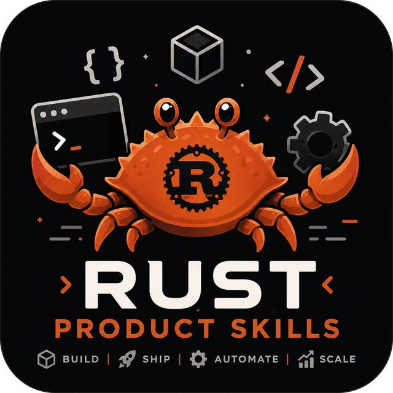
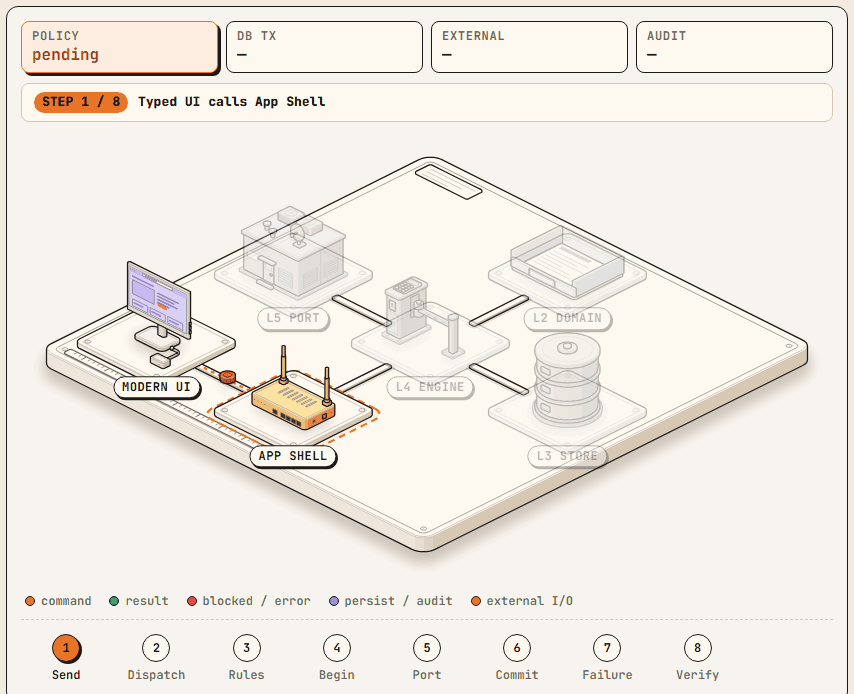
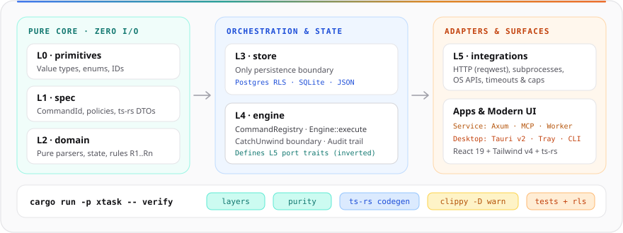
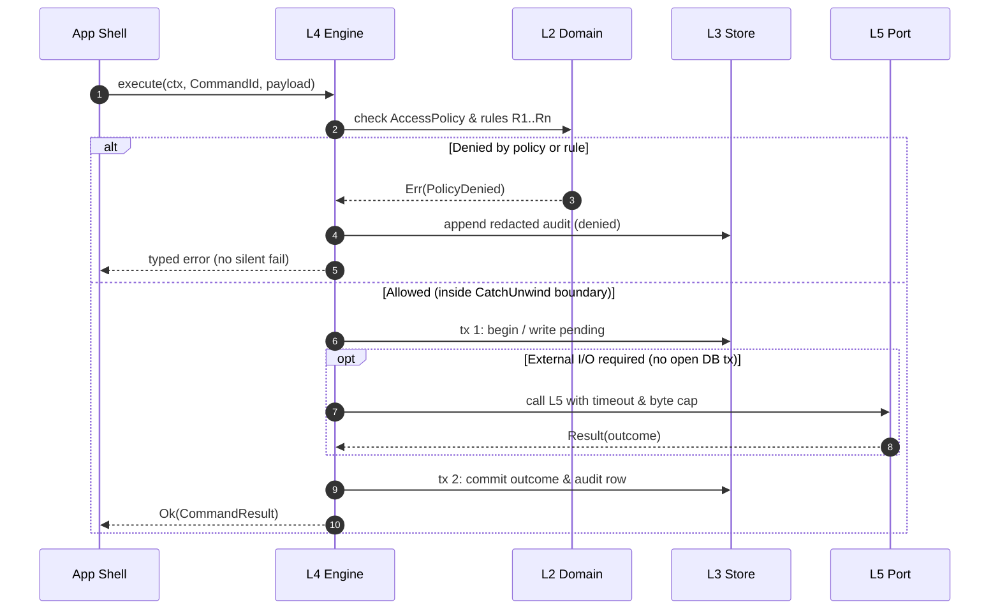

<p align="center">
  
</p>

<h1 align="center">rust-product-skills</h1>

<p align="center"><b>Build a real Rust product from zero, with architecture gates your agent cannot skip.</b><br>
Six modular <a href="https://agentskills.io">agentskills.io</a> skills for coding agents: discover concrete user pain, lock engine rules in a design doc,<br>
scaffold a strict <code>L0</code>–<code>L5</code> Rust Edition 2024 workspace, and pair it with a brand-neutral modern UI.</p>

<p align="center">
  
  <a href="https://skills.sh/"></a>
  
  
  <a href="LICENSE"></a>
  <a href="https://github.com/KJ-AIML/rust-product-skills"></a>
</p>

<p align="center">
  <b><a href="#quick-start">Quick start</a></b> · <a href="#the-6-skills">Skills</a> · <a href="#layered-architecture">Architecture</a> · <a href="#two-app-profiles">App profiles</a> · <a href="#modern-ui-system">Modern UI</a> · <a href="docs/architecture-tour.md">Tour</a> · <a href="#license">MIT</a><br>
  <sub>Works with Antigravity · Claude Code · Codex · Cursor · Gemini CLI · Copilot CLI</sub>
</p>

<table>
  <tr>
    <td width="25%" valign="top">
      <b>Discover</b><br>
      Start from concrete friction, size the MVP honestly, and turn anti-goals into boundaries before touching <code>Cargo.toml</code>.
    </td>
    <td width="25%" valign="top">
      <b>Design</b><br>
      Write a decision-labeled spec (<code>[user]</code> vs <code>[call]</code>) with explicit engine rules <code>R1..Rn</code> a cold reader can build from.
    </td>
    <td width="25%" valign="top">
      <b>Architect &amp; Gate</b><br>
      Scaffold a strict <code>L0</code>–<code>L5</code> workspace where <code>cargo run -p xtask -- verify</code> enforces layers, purity, lints, and <code>ts-rs</code>.
    </td>
    <td width="25%" valign="top">
      <b>Craft UI</b><br>
      Pair the Rust core with a brand-neutral dark-first &amp; light-mode React + Tailwind v4 UI backed by generated TypeScript types.
    </td>
  </tr>
</table>

<p align="center">
  <picture>
    <source media="(prefers-color-scheme: dark)" srcset="docs/assets/runtime-3d-dark.gif">
    
  </picture>
  <br>
  <sub>One command traveling across six isolated <code>L0</code>–<code>L5</code> boundaries: <code>ts-rs</code> bridge, pure <code>R1..Rn</code> checks, short <code>tx 1 → L5 Port → tx 2</code>, and failure isolation. <a href="docs/architecture-tour.md">Full architecture tour</a>.</sub>
</p>

> rust-product-skills is an independent open-source skill collection, not affiliated with or endorsed by the Rust Project
> or the Rust Foundation. "Rust" is a trademark of the Rust Foundation.

## Quick start

Paste this into Antigravity, Claude Code, Codex, Cursor, or Gemini CLI and let your agent install it:

```text
Install rust-product-skills by running `npx skills add KJ-AIML/rust-product-skills`.
Then use `starting-a-rust-product` to walk me through designing and building a new Rust product.
```

Or run it yourself via the [`skills` CLI](https://skills.sh/):

```sh
npx skills add KJ-AIML/rust-product-skills          # install into the current project
npx skills add KJ-AIML/rust-product-skills -g       # install globally for your user
npx skills add KJ-AIML/rust-product-skills --all    # install all 6 skills to all detected agents
npx skills add KJ-AIML/rust-product-skills --list   # preview available skills without installing
```

Only want the Rust backend baseline and UI tokens? Install a subset:

```sh
npx skills add KJ-AIML/rust-product-skills --skill rust-architecture-baseline modern-ui-design
```

Then prompt your coding agent directly, for example:

- *"Use `starting-a-rust-product` to take my service idea from discovery to a verified first slice."*
- *"Write a decision-labeled design doc with `writing-rust-design-docs` and define rules `R1..Rn`."*
- *"Scaffold a new Rust workspace using `rust-architecture-baseline` (Backend Service profile) and wire up `xtask verify`."*
- *"Build the settings and status dashboard with `modern-ui-design`, dark/light tokens, and `ts-rs` bindings."*

<details>
<summary><b>Manual git clone, symlink installers (Windows / macOS / Linux), and agent directories</b></summary>

If you prefer a local git clone so updates arrive with `git pull`:

#### Windows (PowerShell)

```powershell
# Antigravity / Gemini CLI global skills (~/.gemini/config/skills)
.\scripts\install.ps1 -Target antigravity

# Claude Code (~/.claude/skills)
.\scripts\install.ps1 -Target claude

# Codex / cross-agent (~/.agents/skills)
.\scripts\install.ps1 -Target agents

# Project-local workspace (.agents/skills in a target repo)
.\scripts\install.ps1 -Target workspace -WorkspacePath D:\path\to\your-project
```

#### macOS / Linux

```sh
# Default: ~/.agents/skills (supports: antigravity | claude | agents | workspace)
./scripts/install.sh --target agents
```

#### Agent skill directories

| Agent | Skill directory |
| :--- | :--- |
| Antigravity / Gemini CLI (global) | `~/.gemini/config/skills/` |
| Antigravity (project workspace) | `<repo>/.agents/skills/` |
| Claude Code (personal) | `~/.claude/skills/` |
| Claude Code (project) | `<repo>/.claude/skills/` |
| Codex / Copilot CLI / multi-agent | `~/.agents/skills/` |

</details>

## The 6 skills

Each skill follows the open [agentskills.io](https://agentskills.io) specification so you can run the full gated lifecycle from scratch or invoke any single skill on an existing repository.

| Stage | Skill | Focus & bundled references |
| :---: | :--- | :--- |
| 0 | [`starting-a-rust-product`](skills/starting-a-rust-product/SKILL.md) | End-to-end lifecycle map, stop-and-approve gates (and autonomous fast-track rules) from idea to verified first slice |
| 1 | [`discovering-product-pain`](skills/discovering-product-pain/SKILL.md) | Concrete friction discovery, realistic MVP scope sizing (`F1..F8`), profile choice, and non-negotiable anti-goals |
| 2 | [`writing-rust-design-docs`](skills/writing-rust-design-docs/SKILL.md) | Decision-labeled specs (`[user]` vs `[call]`), engine-enforced rules `R1..Rn`, cold-reader check · [`design-doc-template.md`](skills/writing-rust-design-docs/references/design-doc-template.md) |
| 3 | [`rust-architecture-baseline`](skills/rust-architecture-baseline/SKILL.md) | `L0`–`L5` layered Rust Edition 2024 workspace, strict deny lints, `Engine::execute`, `xtask verify` · [`workspace-scaffold.md`](skills/rust-architecture-baseline/references/workspace-scaffold.md) |
| 4 | [`planning-rust-builds`](skills/planning-rust-builds/SKILL.md) | Phase 1–2 bottom-up DAG plans, top 5 failure modes, cross-platform & Windows gotchas · [`plan-template.md`](skills/planning-rust-builds/references/plan-template.md) |
| 5 | [`modern-ui-design`](skills/modern-ui-design/SKILL.md) | Brand-neutral dark-first + light-mode token system, hairline surfaces, React + Vite + Tailwind v4 + `ts-rs` · [`design-tokens.md`](skills/modern-ui-design/references/design-tokens.md) · [`component-patterns.md`](skills/modern-ui-design/references/component-patterns.md) |

## Layered architecture

`rust-architecture-baseline` enforces a strict one-way dependency DAG so business logic stays deterministic, fast to test, and impossible to tangle with HTTP handlers, SQL drivers, or OS subprocesses.

<p align="center">
  <picture>
    <source media="(prefers-color-scheme: dark)" srcset="docs/assets/architecture-dark.svg">
    
  </picture>
  <br>
  <sub>One <code>L0</code>–<code>L5</code> core with inverted <code>L5</code> port traits powers both Backend Services (Axum / MCP) and Desktop / CLI apps (Tauri v2).</sub>
</p>

| Layer | Crate | Depends on | Enforced invariant |
| :---: | :--- | :--- | :--- |
| `L0` | `primitives` | std / serde only | Value types, strongly typed IDs, domain enums — zero I/O, zero async |
| `L1` | `spec` | `L0` | `CommandId`, `AccessPolicy`, error enums, `ts-rs` frontend contracts — zero I/O |
| `L2` | `domain` | `L0`, `L1` | Pure parsers, state machines, and rules `R1..Rn` — deterministic, zero I/O |
| `L3` | `store` | `L0`–`L2` | Only crate allowed to touch persistence (Postgres RLS, SQLite, or atomic JSON) |
| `L4` | `engine` | `L0`–`L3` | `CommandRegistry`, `Engine::execute`, `CatchUnwind` panic boundary, audit log, and **inverted `L5` port traits** |
| `L5` | `integrations` | `L0`, `L4` (ports) | External HTTP (`reqwest`), subprocesses, OS/system calls with explicit timeouts and byte caps |
| `App` | `apps/*` | `L0`–`L5` | Thin delivery shells: Axum / MCP server, background worker, Tauri v2 desktop, or Clap CLI |

### Inside `Engine::execute`

Every state-changing action crosses one fixed pipeline so commands never bypass policy checks, never write ad-hoc audit rows, never panic across the boundary, and never hold a database transaction open across external network or OS calls:



### Mechanically enforced by `xtask verify`

Conventions drift when agents iterate quickly. Every workspace generated with these skills ships a single verification entrypoint (`cargo run -p xtask -- verify`) that checks:

- **Strict lints**: `unsafe_code = "forbid"`, plus `unwrap_used`, `expect_used`, `panic`, `todo`, `unimplemented`, `unreachable`, `dbg`, and `as_conversions` denied under `clippy --all-targets -- -D warnings`.
- **Layer DAG & source purity**: `xtask` walks `cargo metadata` and `L0`–`L2` source files so forbidden crates (`tokio`, `reqwest`, `sqlx`, `std::fs`, `std::process`, `std::net`) can never sneak into the pure core.
- **TypeScript contract sync**: `ts-rs` exports Rust DTOs cleanly into the frontend without manual drift.
- **Database & tenant safety**: Integration tests plus optional Postgres Row-Level Security (`RLS`) checks for multi-tenant services.

<details>
<summary><b>Rust Edition 2024 &amp; cross-platform gotchas already guarded by these skills</b></summary>

| Failure mode / trap | Why it bites | Mechanical fix baked into the skills |
| :--- | :--- | :--- |
| Edition 2024 `gen` &amp; `collapsible-if` | `gen` is a reserved keyword; `let`-chains fail under `-D warnings` | Use `epoch` / `rev` and collapsed `if let` chains from Task 1 |
| `#[tauri::command]` + `unreachable` lint | Macro expansion emits `unreachable!()`, tripping workspace deny | Isolate thin IPC wrappers in `mod ipc { #![allow(clippy::unreachable)] }` |
| `ts-rs` exporting `u64`/`i64` as `bigint` | Breaks JSON number interop in React/TypeScript | Annotate numeric fields with `#[ts(type = "number")]` and `#[ts(optional)]` |
| Windows subprocess window flash | Console window flashes when a Tauri GUI spawns a CLI | Set `.creation_flags(0x0800_0000)` (`CREATE_NO_WINDOW`) under `#[cfg(windows)]` |
| `xtask` passes on Linux, fails on Windows | Backslash paths break string checks | Normalize all paths with `.replace('\\', "/")` inside `xtask` |
| Shell / SQL scripts break on checkout | CRLF line endings break bash/migrations | Enforce `*.sh`, `*.sql`, `*.rs`, `*.toml` as `text eol=lf` in `.gitattributes` |

</details>

## Two app profiles

The same `L0`–`L5` core adapts to two production deployment shapes documented directly in `rust-architecture-baseline`:

| Concern | [Backend Service Profile](skills/rust-architecture-baseline/references/backend-service-profile.md) | [Desktop & CLI Profile](skills/rust-architecture-baseline/references/desktop-cli-profile.md) |
| :--- | :--- | :--- |
| **Delivery surfaces** | Axum HTTP API, MCP server, background workers | Tauri v2 desktop app, system tray, Clap CLI |
| **Persistence (`L3`)** | Postgres (`sqlx` + forced RLS) or SQLite (WAL) | Atomic JSON / SQLite in OS app-data directory |
| **Isolation & auth** | Per-tenant auth context & automated RLS verification | Local config boundaries, `CREATE_NO_WINDOW` subprocess safety on Windows |
| **Frontend contract** | REST / SSE / JSON-RPC + `ts-rs` bindings | Thin `#[tauri::command]` IPC delegating to `Engine::execute` + `ts-rs` |
| **External I/O (`L5`)** | Outbound webhooks, LLM/API clients, queues | Local CLI probes, OS networking, native integrations |

## Modern UI system

[`modern-ui-design`](skills/modern-ui-design/SKILL.md) provides a clean, **completely brand-neutral** UI foundation for React 19 + Vite + Tailwind CSS v4 so your Rust product looks crisp on day one without inheriting someone else's brand identity:

- **Dark-first with true light-mode parity** via semantic CSS custom properties ([`design-tokens.md`](skills/modern-ui-design/references/design-tokens.md)).
- **Hairline surfaces & high contrast** with restrained accents, `tabular-nums` alignment for telemetry/metrics, and accessible focus states.
- **Practical component patterns** for app shells, dense data tables, command dialogs, empty/error states, browser Preview Mode, and reduced-motion discipline ([`component-patterns.md`](skills/modern-ui-design/references/component-patterns.md)).
- **Zero duplicated schemas** — Rust `L1 spec` types generate TypeScript definitions via `ts-rs` and are checked in `xtask verify`.

## Learn more

- [Architecture & Lifecycle Tour](docs/architecture-tour.md): full walkthrough of all 5 stages, `L0`–`L5` Mermaid DAG, `Engine::execute` sequence, profile comparison, and Rust 2024 gotchas
- [Workspace & `xtask verify` scaffold](skills/rust-architecture-baseline/references/workspace-scaffold.md): root `Cargo.toml` lints, `rust-toolchain.toml`, and `xtask` gate implementation
- [Backend Service profile](skills/rust-architecture-baseline/references/backend-service-profile.md) · [Desktop & CLI profile](skills/rust-architecture-baseline/references/desktop-cli-profile.md)
- [ADR design doc template](skills/writing-rust-design-docs/references/design-doc-template.md) · [Phase 1–2 build plan template](skills/planning-rust-builds/references/plan-template.md)
- [Design tokens (Dark + Light)](skills/modern-ui-design/references/design-tokens.md) · [Component patterns & UI verification](skills/modern-ui-design/references/component-patterns.md)

## Contributing

Issues and pull requests are welcome. When editing or adding skills:

- Keep every skill in valid [agentskills.io](https://agentskills.io) `SKILL.md` format under `skills/<skill-name>/`.
- Keep all templates, tokens, and examples brand-neutral and self-contained.
- Verify skill discovery with `npx skills add . --list` before opening a PR.

## License

[MIT](./LICENSE)
