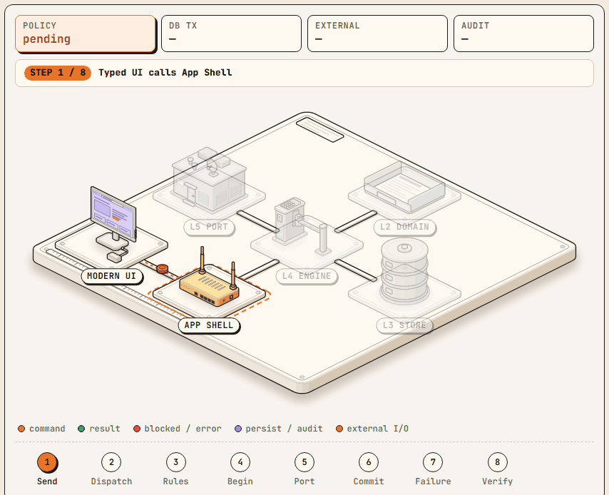
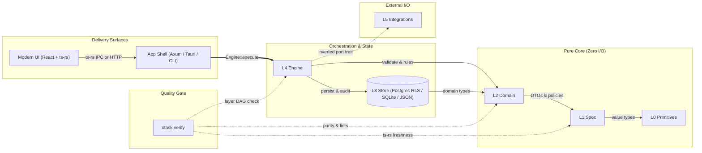
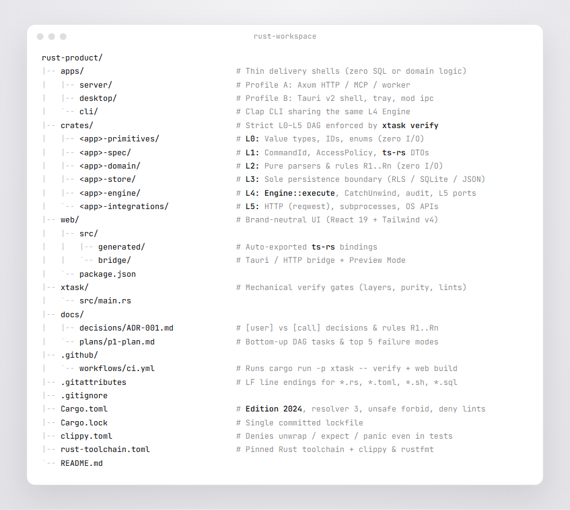
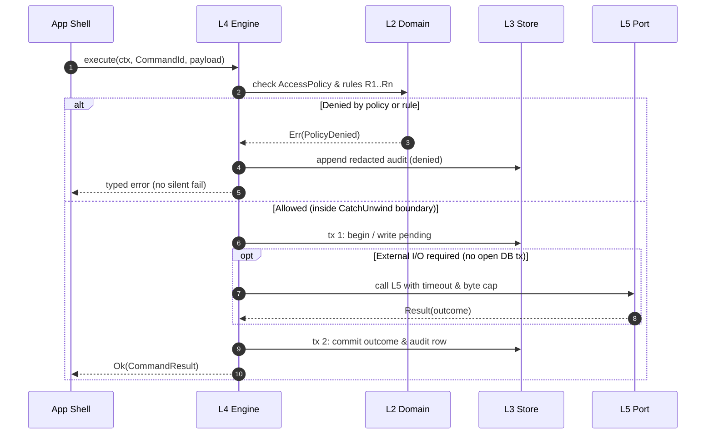

# Rust Product Skills · Architecture & Lifecycle Tour

_How six modular skills take a Rust product from concrete user pain to a verified `L0`–`L5` Edition 2024 workspace and modern UI._

> `KJ-AIML/rust-product-skills` is a brand-neutral kit of six `agentskills.io` skills for coding agents. Every anti-goal becomes a tested engine rule (`R1..Rn`), and every architectural boundary is checked mechanically by `cargo run -p xtask -- verify`.

  <picture>
    <source media="(prefers-color-scheme: dark)" srcset="assets/runtime-3d-dark.gif">
    
  </picture>
   
  Animated 3D runtime flow: one command crosses six isolated components, including <code>tx 1 → L5 Port → tx 2</code> and failure isolation.

## 1. Why This Skill Kit Exists

Coding agents move fast, which makes architectural drift happen fast too: they scaffold crates before the real problem is clear, scatter `.unwrap()` calls across handlers, mix SQL or HTTP into business logic, and duplicate Rust structs by hand in TypeScript.

`rust-product-skills` turns Rust product engineering discipline into six composable skills with **zero locked-in brand identity**:

- **Problem before crates.** Discovery locks down concrete friction, lean v1 scope (`F1..F8`), and trust-breaking anti-goals before touching `Cargo.toml`.
- **Rules in the engine, not the UI.** Every anti-goal maps to a testable domain/engine check (`R1..Rn`) enforced inside `Engine::execute`, never just a disabled button.
- **Mechanical gates over tribal memory.** `cargo run -p xtask -- verify` checks layer DAGs, `L0`–`L2` purity, `ts-rs` TypeScript sync, strict deny lints, and tests on every change.
- **One core, two app shapes.** The same `L0`–`L5` workspace powers multi-tenant Backend Services (Axum / MCP + Postgres RLS) and local Desktop / CLI apps (Tauri v2 + atomic store).

## 2. The 5-Stage Lifecycle & Approval Gates

Orchestrated by [`starting-a-rust-product`](../skills/starting-a-rust-product/SKILL.md): never bundle the design doc and build plan in the same message — one gate at a time avoids wasted rework.

| Stage | Skill | Output | Gated Flow (Default) | Autonomous Fast-Track |
| :---: | :--- | :--- | :--- | :--- |
| 1 | [`discovering-product-pain`](../skills/discovering-product-pain/SKILL.md) | Pain playback, `F1..F8`, profile, anti-goal | User confirms playback | Summarize assumptions briefly |
| 2 | [`writing-rust-design-docs`](../skills/writing-rust-design-docs/SKILL.md) | `ADR-001` (`[user]` vs `[call]`, `R1..Rn`) | User approves ADR & rules | Record `ADR-001` + `[call]` log |
| 3 | [`planning-rust-builds`](../skills/planning-rust-builds/SKILL.md) | Phase 1–2 bottom-up DAG plan | User approves build plan | Sequence Phase 1–2 inline |
| 4 | [`rust-architecture-baseline`](../skills/rust-architecture-baseline/SKILL.md) | `L0`–`L5` crates + `xtask verify` + first slice | `cargo run -p xtask -- verify` passes | `cargo run -p xtask -- verify` passes |
| 5 | [`modern-ui-design`](../skills/modern-ui-design/SKILL.md) | React + Tailwind v4 UI + `ts-rs` + Preview Mode | `tsc`, `vite build`, visual check pass | `tsc`, `vite build`, visual check pass |

> [!TIP]
> Human gates protect product scope in Stages 1–3; mechanical gates (`xtask verify`, `tsc`, visual checks) protect code quality in Stages 4–5 — even in autonomous mode.

## 3. Layered Workspace DAG & Mechanical Verification

Dependencies and calls flow strictly left to right from delivery shells into orchestration, persistence/ports, and the pure zero-I/O core. Dashed arrows mark inverted `L5` port traits and `xtask verify` checks.

**Route 1 — Command execution:**

1. `Modern UI` → `App Shell`: The UI calls a typed Bridge method backed by `ts-rs` contracts.
2. `App Shell` → `L4 Engine`: Thin route or `#[tauri::command]` delegates straight to `Engine::execute`.
3. `L4 Engine` → `L2 Domain`: Default-deny `AccessPolicy` and pure rules `R1..Rn` validate the command.
4. `L4 Engine` → `L3 Store`: `L3` persists state atomically (or runs short `tx 1` before external calls).
5. `L4 Engine` → `L5 Integrations`: If external I/O is needed, `L4` calls an injected port trait implemented in `L5`.
6. `L4 Engine`: `CatchUnwind` catches panics and records a redacted audit entry centrally.

**Route 2 — `xtask verify` gate:**

1. Runs `cargo run -p xtask -- verify`.
2. Walks `cargo metadata` to prove the `L0`–`L5` dependency DAG has zero upward or sideways leaks.
3. Scans `L0`–`L2` source for forbidden I/O (`tokio`, `reqwest`, `sqlx`, `std::fs`, `std::process`, `std::net`).
4. Exports `ts-rs` bindings and verifies frontend TypeScript types match Rust with zero drift.
5. Runs `clippy --all-targets -- -D warnings` (`unsafe` forbidden; `unwrap`/`expect`/`panic`/`as` denied) and the full test suite.

### Generated Workspace Layout

  <picture>
    <source media="(prefers-color-scheme: dark)" srcset="assets/workspace-tree-dark.png">
    
  </picture>

## 4. Inside `Engine::execute` (Pipeline & Safety Boundaries)

Every state-changing action crosses one fixed pipeline. Unauthorized calls, panics, and live external I/O stay isolated without corrupting state or holding an open database transaction.

## 5. Backend Service vs. Desktop & CLI Profiles

Both profiles share the exact same `L0`–`L5` crate rules and `xtask verify` harness; only the outer persistence, isolation, and delivery layers change.

| Concern | [Backend Service Profile](../skills/rust-architecture-baseline/references/backend-service-profile.md) | [Desktop & CLI Profile](../skills/rust-architecture-baseline/references/desktop-cli-profile.md) | Why they differ |
| :--- | :--- | :--- | :--- |
| **Delivery shell** | Axum HTTP, MCP server, workers | Tauri v2 window, tray, Clap CLI | Network services serve concurrent clients; local tools run single-user on the OS |
| **`L3 store`** | Postgres + forced RLS (or SQLite WAL) | Atomic JSON / SQLite in app-data | Multi-tenant services need DB-enforced tenant isolation; desktop tools need crash-safe local files |
| **External I/O (`L5`)** | Outbound webhooks, APIs, queues | OS probes, subprocesses, local tools | Windows GUI apps must set `CREATE_NO_WINDOW` (`0x0800_0000`) to prevent console flashes |
| **Frontend bridge** | REST / SSE / JSON-RPC + `ts-rs` | Thin `mod ipc` (`#[tauri::command]`) + `ts-rs` | Both share `createPreviewBridge` so UI states can be inspected in a plain browser |
| **Extra `xtask` gate** | `rls` tenant-isolation test gate | Cross-platform path & bundle check | Catches cross-tenant leaks on servers and backslash/toolchain regressions on Windows |

## 6. Baseline Invariants & Rust 2024 Gotchas

Cross-platform and Edition 2024 traps already guarded inside [`planning-rust-builds`](../skills/planning-rust-builds/SKILL.md) and [`rust-architecture-baseline`](../skills/rust-architecture-baseline/SKILL.md):

| Failure mode / trap | Why it bites | Mechanical fix baked into the skills |
| :--- | :--- | :--- |
| `.unwrap()` / `.expect()` / `as` casts | Silent production panics or integer truncation | Workspace lints deny them under `clippy -D warnings`; `unsafe_code = "forbid"` |
| `L0`–`L2` importing `tokio` / `std::fs` | Pure domain logic becomes slow and flaky to test | `xtask purity` scans source + `cargo metadata` DAG on every verify |
| Edition 2024 `gen` & `collapsible-if` | `gen` is a reserved keyword; `let`-chains trigger `-D warnings` | Use `epoch` / `rev` and collapsed `if let` chains upfront |
| `#[tauri::command]` + `unreachable` lint | Macro expansion emits `unreachable!()`, tripping workspace deny | Isolate thin wrappers in `mod ipc { #![allow(clippy::unreachable)] }` |
| `ts-rs` exporting `u64`/`i64` as `bigint` | Breaks JSON number interop in React/TypeScript | Annotate numeric fields with `#[ts(type = "number")]` and `#[ts(optional)]` |
| Windows subprocess window flash & paths | Console window pops up in Tauri GUI; `\` breaks `xtask` checks | Set `CREATE_NO_WINDOW` under `#[cfg(windows)]` and normalize `/` in `xtask` |

---

← Back to [README](../README.md)
